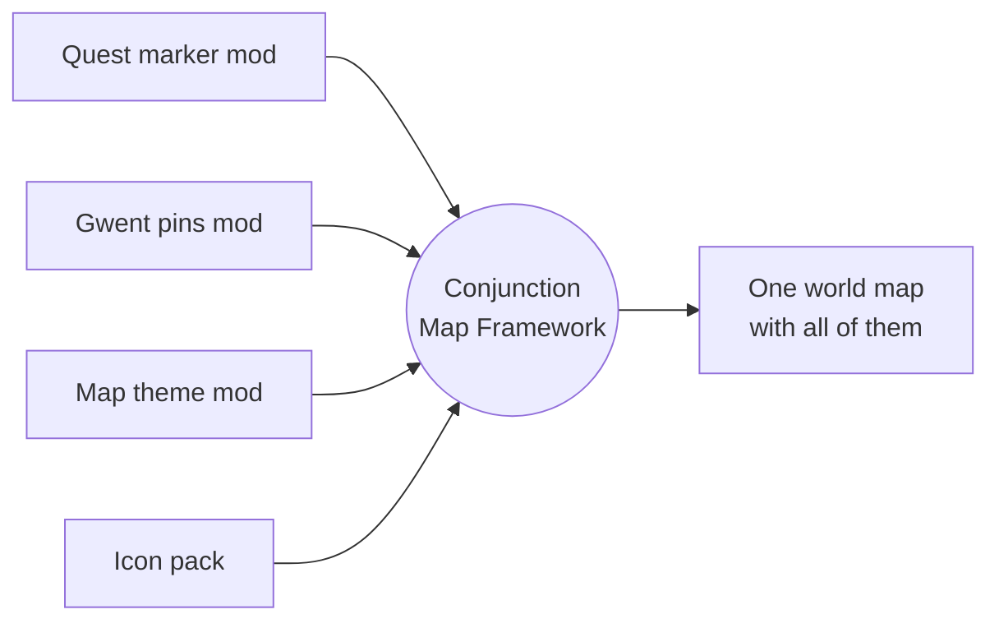

<div align="center">

# Conjunction Map Framework

**One world map for The Witcher 3 that every map mod can share.**

[](https://github.com/KyleCo76/Conjunction-Map-Framework/releases/latest)


[](LICENSE)

[**Download on Nexus Mods**](NEXUS_PAGE_URL) · [**GitHub Releases**](https://github.com/KyleCo76/Conjunction-Map-Framework/releases) · [**For mod authors**](docs/wiki/Home.md) · [**Report a problem**](#reporting-problems)

</div>

---

## The problem CMF solves

In The Witcher 3 only **one** mod's world map file can load at a time. Map mods used to ship their own copy of that file, so whichever copy won switched off the map features of every other map mod: quest markers from one mod, Gwent pins from another and a travel route from a third could never all show together.

**Conjunction Map Framework (CMF)** becomes the game's one map. Other mods no longer replace the map; they tell CMF what they want shown. CMF settles once, when your game loads, whose icon, colour or legend row wins each spot, and draws the result every time you open the map.

> [!TIP]
> **Ink & Iron on CMF's map.** Ink & Iron's full map look, its "Lv N" quest tags and its smooth map movement all run on CMF's map. The same goes for the other mods under [Supported map mods](#supported-map-mods), including Map Quest Insight, Witcher's Path, Gwent Players Map, All Quest Objectives and Map Remastered. CMF's own adapters do the proof-of-concept work, so none of these mods needed work from their authors for initial compatibility. The final check ran on a 175-mod everyday game, installed with RMMR.



> [!NOTE]
> **On its own, CMF changes nothing you can see.** With only CMF installed, the map looks exactly like the game's own. What it becomes depends on the CMF-ready mods and adapters you install beside it.

## Contents

- [For players](#for-players)
  - [What you need](#what-you-need)
  - [What is in 1.0.0](#what-is-in-100)
  - [Installing](#installing)
  - [Supported map mods](#supported-map-mods)
  - [Good to know](#good-to-know)
- [For mod authors](#for-mod-authors)
  - [What CMF can do for your mod](#what-cmf-can-do-for-your-mod)
  - [Your first pack in five steps](#your-first-pack-in-five-steps)
  - [Documentation](#documentation)
  - [Porting a mod that has a CMF adapter](#porting-a-mod-that-has-a-cmf-adapter)
- [Repository guide](#repository-guide)
- [Releases and checking a download](#releases-and-checking-a-download)
- [Reporting problems](#reporting-problems)
- [Credits and licence](#credits-and-licence)

---

## For players

### What you need

- **The Witcher 3: Wild Hunt Remastered**, Steam patch **5.01** (build 5.0.1048522), DirectX 12, on Windows.
- For each adapter: the mod it adapts, at the version named in the table below.

### What is in 1.0.0

1.0.0 is 13 separate archives. You always need the first one; take the rest only for the mods you play with.

| Archive | What it is | When to install it |
| --- | --- | --- |
| `mod0000_ConjunctionMapFramework` | CMF itself | **Always** |
| `modCMFMinimapPanel` | Minimap add-on: your icon packs' icons and colours on the HUD minimap too | Optional. Never beside another mod that changes the minimap (see [Good to know](#good-to-know)) |
| `modCMFExampleIconPack` | Sample icon pack: a small example for pack authors | Optional |
| `modCMFAdapter…` (10 archives) | Adapters for 10 map mods that don't support CMF yet | Only for those mods you use, and only until the mod's author updates it for CMF. See [Supported map mods](#supported-map-mods) |

### Installing

1. Install CMF: copy its `Mods` and `bin` folders into your game folder and let Windows merge them.
2. Install your map mods as their authors describe.
3. If one of those mods is in the adapter list below, add its adapter's `Mods` folder. Many map mods need no adapter at all, and an adapter is only needed until that mod's author updates it for CMF.
4. Optionally add the minimap add-on.
5. Start the game. The first start recompiles scripts and takes a little longer.

Every archive has a `README.txt` with its full install, update and removal steps. To remove CMF later, take out adapters and packs first, then the minimap add-on, then CMF. CMF writes nothing into your saves.

### Supported map mods

Many map mods work with CMF as they are, with no adapter. An **adapter** is a small stand-in for a mod that doesn't support CMF yet: it brings that mod's map features back on CMF's map while the mod itself stays exactly as its author ships it. Once the author updates the mod for CMF, you remove the adapter. Adapters **contain none of the mod they adapt**, add no features of their own, and **only work with that mod installed**: without it, the game stops at the script compile screen.

| Mod | Tested version | What the adapter brings back |
| --- | --- | --- |
| All Quest Objectives On Map - Remastered | 1.2.1 | Difficulty icons on quest objectives, its legend row, removing cached merchant pins |
| Botanist - NG - Remastered | 3.0.0.2 | Its herb markers and legend rows |
| Fog of War | 1.2.1 | Hides every map icon under the fog, including other mods' icons |
| Gwent Players Map | 1.0.9 | Its card markers and its "Gwent" tab |
| Ink and Iron - All in One | 0.8.8 (0.8.7 works too) | Ink and Iron's map look, quest level tags, key-hint row and map movement |
| Map Pin Teleport | 1.2.2 | Teleporting from your own map pins |
| Map Quest Insight | 1.6.1 | Quest icons by type, coloured level labels, its info box, spreading stacked markers |
| The Stable - Roach-Horse Customization | 2.2.1 | Its Stables row on the map |
| Witcher Upgrade Gear Map | 1.0.1 | Its diagram markers, "Witcher Gear" tab and legend row |
| Witcher's Path | 1.0.3 | Its travel route drawn on the map, and its buttons |

<details>
<summary><b>Tested with no adapter needed, and mods that need their author's update</b></summary>

<br/>

**Tested, no adapter needed:** Map Remastered 2.4.2 (without the minimap add-on), All Quest Markers, Wild Monster Hunt, Wolf's Bearing, Apocrypha Menu Framework 1.0.6, HUD Position Manager 1.0.0.

**Not supported yet (needs its author's update):** some map mods keep their map features, and often their icon art, inside their own copy of the world map file. CMF never copies another mod's art or files, so those features stay hidden under CMF until the author updates the mod for CMF or gives permission for an adapter to use them. The mod's scripts and menus keep working meanwhile. UI Remastered Edition was tested this way: its HUD and menus work, CMF's map opens. Smooth Map and Community Patch - World Map are in the same group: everything they change lives in their own map file, so 1.0.0 has no adapter for them.

The full, current list is on the [Nexus Mods page](NEXUS_PAGE_URL).

</details>

<details>
<summary><b>Known differences in 1.0.0</b></summary>

<br/>

- **Placeholder art** in the All Quest Objectives, Botanist, Gwent Players Map, Map Quest Insight and Witcher Gear Map adapters, until those authors supply theirs. CMF never ships another mod's art.
- **Fog of War's clouds** do not draw on CMF's map until Fog of War supports CMF; the hiding works.
- **Map Remastered's** own region emblems on the world overview do not show; its redrawn terrain does.
- **Witcher's Path:** its speed setting does nothing under CMF.
- **Map Pin Teleport:** the "Go Now" texts are English, as in the mod itself.
- Per-mod details are in each adapter's `README.txt` and in the release's `test-notes.md`.

</details>

### Good to know

- **When two mods want the same spot**, a "hide" always wins; otherwise the mod whose folder name sorts first wins. Your mod manager's load order does not change this. To pick a winner yourself, list folder names in `Documents\The Witcher 3\dx12user.settings` (details in the [author guide, section 11](docs/authors/icon-pack-guide.md#11-for-players-installing-cmf-icon-packs-and-other-map-mods)):
  ```ini
  [CMFSettings]
  CMFProviderOrder1=modMyFavouritePack
  CMFProviderOrder2=modOtherPack
  ```
- **When a mod ships its own CMF support, uninstall CMF's adapter for it.** With both installed, the game stops at the script compile screen.
- **The minimap add-on replaces the game's minimap.** Do not install it with any other mod that does: HUD Position Manager, UI Remastered Edition, Ink and Iron (its HUD), Map Remastered, Map Icons - Remastered, Colorized Map Icons, Coloured Map Marker.
- **Do not give another map mod a lower `Priority` than CMF** in `mods.settings`; that switches CMF's map off.
- **The map moves at 60 frames per second** by default.

> [!IMPORTANT]
> **Not tested:** controllers and Proton / Linux. CMF 1.0.0 was tested on Windows with keyboard and mouse, both with the files copied in by hand and installed with RMMR in a full, everyday game setup.

---

## For mod authors

CMF lets your mod change the world map **without shipping a map file**: no decompiling Flash, no Script Merger, no compatibility patches for other map mods. Your mod calls CMF from its own scripts, and works beside every other mod that uses CMF.

Three rules shape everything CMF offers:

1. **Abilities, not special cases.** Every ability is one general call that takes its target as an argument. CMF has no calls made for one particular mod, and names (pin types, tags, tab ids, folder names) are open, so your mod can style a pin another mod added.
2. **Clear winners.** When two mods ask for the same thing, a hide wins; otherwise the folder name that sorts first wins, unless the player sets an order. CMF settles this once per game load.
3. **The version number is a promise.** `CMFGetVersion()` returns CMF's script interface version (**6** in 1.0.0), not a release number. Nothing is removed from 1.0.0 on; later versions only add.

### What CMF can do for your mod

| Ability | Since API version | Guide section |
| --- | --- | --- |
| Pin icons, legend icons and colour tints, for a whole pin type or one pin by its tag | 1 | [The CMF calls](docs/authors/icon-pack-guide.md#the-cmf-calls) |
| Replace a map area's background image | 1 | [The CMF calls](docs/authors/icon-pack-guide.md#the-cmf-calls) |
| Grey out pins (looks only, they stay usable) | 1 | [Greying pins](docs/authors/icon-pack-guide.md#greying-pins-api-version-1) |
| Your own legend rows and filter tabs | 2 | [Legend rows and filter tabs](docs/authors/icon-pack-guide.md#legend-rows-and-filter-tabs-api-version-2) |
| Style a single pin as the map builds it | 2 | [Styling one pin](docs/authors/icon-pack-guide.md#styling-one-pin-api-version-2) |
| Hide pins, with exemptions for tracked, quest and fast travel pins | 3 | [Hiding pins](docs/authors/icon-pack-guide.md#hiding-pins-api-version-3) |
| Pin size, pin labels, the info box height, hiding pins in a filter tab | 4 | [Pin size, labels and the info box](docs/authors/icon-pack-guide.md#pin-size-labels-and-the-info-box-api-version-4) |
| A hook on every pin as the map builds it (`CMFCore.OnPinReady`) | 4 | [The pin hook](docs/authors/icon-pack-guide.md#the-pin-hook-onpinready-api-version-4) |
| Key hints and filter tab reports | 4 | [Key hints](docs/authors/icon-pack-guide.md#key-hints-and-filter-tab-reports-api-version-4) |
| A full map theme: frames, fonts, colours, legend and backdrop | 5 | [The map theme](docs/authors/icon-pack-guide.md#the-map-theme-api-version-5) |
| Pin clicks handed back to your script, with button text | 6 | [Pin clicks](docs/authors/icon-pack-guide.md#pin-clicks-api-version-6) |
| Smooth map movement | 6 | [Smooth map movement](docs/authors/icon-pack-guide.md#smooth-map-movement-api-version-6) |
| Spreading stacked pins apart | 6 | [Spreading stacked pins](docs/authors/icon-pack-guide.md#spreading-stacked-pins-api-version-6) |
| Drawing lines and images on the map itself | 6 | [Drawing on the map](docs/authors/icon-pack-guide.md#drawing-on-the-map-itself-api-version-6) |

A minimal pack, the whole script:

```c
@wrapMethod(CR4Game)
function OnGameStarted(restored : bool)
{
	var result : bool;
	result = wrappedMethod(restored);
	if (CMFRequireVersion("modAcmeIcons", 1))
	{
		CMFRegisterIcon("modAcmeIcons", 'Innkeeper', "img://icons/modacmeicons/innkeeper.png");
		CMFRegisterTint("modAcmeIcons", 'Herbalist', 4259648); // 0x40FF40, lime green
	}
	return result;
}
```

<sub>The same pattern as the [sample icon pack's script](examples/modCMFExampleIconPack/content/scripts/local/modcmfexampleiconpack_cmf.ws). `tools/cmf_pack.py skeleton` writes the start-up script for your own pack.</sub>

> [!WARNING]
> Calling a CMF function that the installed CMF does not have stops the game at the script compile screen. Check with `CMFHasProperty(id)` or `CMFRequireVersion(provider, version)` before using anything newer than the version your mod requires, and never name your own functions with the `CMF` prefix.

### Your first pack in five steps

1. Copy [`examples/modCMFExampleIconPack`](examples/modCMFExampleIconPack/) and rename the folder, for example `modAcmeIcons`.
2. Put your PNG icons in its `art/` folder.
3. Run `python tools/cmf_pack.py skeleton path/to/modAcmeIcons` and paste what it prints into your start-up script.
4. Write the player `README.txt` from [the template](docs/authors/pack-readme-template.txt).
5. Run `python tools/cmf_pack.py build path/to/modAcmeIcons --out path/to/out`, fix anything it reports, and copy the `Mods` folder it writes into the game.

The pack tool needs only Python 3 and its standard library. It checks your art and script and builds the texture cache the game reads.

### Documentation

| Document | What is in it |
| --- | --- |
| [Mod author docs](docs/wiki/Home.md) | **Start here.** The guide as short pages, one per ability, with an API reference |
| [Author guide](docs/authors/icon-pack-guide.md) | Everything: art, every CMF call by API version, building, testing, shipping, settings and text, what CMF does not do yet |
| [Pin types](docs/authors/pin-types.md) | All 162 pin type names of the 5.01 world map, with their legend tab and what a claim on each changes |
| [Porting pages](docs/authors/) | One page per adapted mod: "you used to do this; now call these CMF functions" |
| [Script-side map bindings](docs/api/engine-bindings.md) | Advanced: the callbacks and values that pass between scripts and CMF's map |

> **New to CMF?** Start at the [mod author docs](docs/wiki/Home.md): the same guide split into short pages, one per topic, from [what you want to change](docs/wiki/Abilities.md) to [getting started](docs/wiki/Getting-Started.md) and a full [API reference](docs/wiki/API-Reference.md).

### Porting a mod that has a CMF adapter

The adapters are teaching examples, written as the code that mod's own author would add. If your mod has one, its porting page shows the CMF calls that give the same result once your mod supports CMF itself. Fold them into your mod (CMF then becomes a requirement), and the standalone adapter is retired: players uninstall it and use your release.

| Your mod | Porting page | Adapter source |
| --- | --- | --- |
| All Quest Objectives On Map - Remastered | [page](docs/authors/all-quest-objectives-adapter.md) | [source](source/adapters/all-quest-objectives/) |
| Botanist - NG - Remastered | [page](docs/authors/botanist-adapter.md) | [source](source/adapters/botanist/) |
| Fog of War | [page](docs/authors/fog-of-war-adapter.md) | [source](source/adapters/fog-of-war/) |
| Gwent Players Map | [page](docs/authors/gwent-players-map-adapter.md) | [source](source/adapters/gwent-players-map/) |
| Ink and Iron | [page](docs/authors/ink-and-iron-adapter.md) | [source](source/adapters/ink-and-iron/) |
| Map Pin Teleport | [page](docs/authors/map-pin-teleport-adapter.md) | [source](source/adapters/map-pin-teleport/) |
| Map Quest Insight | [page](docs/authors/map-quest-insight-adapter.md) | [source](source/adapters/map-quest-insight/) |
| The Stable | [page](docs/authors/the-stable-adapter.md) | [source](source/adapters/the-stable/) |
| Witcher Upgrade Gear Map | [page](docs/authors/witcher-gear-map-adapter.md) | [source](source/adapters/witcher-gear-map/) |
| Witcher's Path | [page](docs/authors/witchers-path-adapter.md) | [source](source/adapters/witchers-path/) |

Smooth Map and Community Patch - World Map have porting sections in the [author guide, section 12](docs/authors/icon-pack-guide.md#12-teaching-examples-moving-a-map-mod-onto-cmf), but no adapter ships for them.

---

## Repository guide

<details>
<summary><b>What is where</b></summary>

<br/>

| Path | What |
| --- | --- |
| `source/core` | CMF's scripts (`cmfCore.ws`, `cmfSettings.ws`) |
| `source/settings`, `source/strings.json` | CMF's menu file and the source of its string tables |
| `source/panel` | the edit sets CMF applies to the game's world map and minimap panels, and CMF's own ActionScript classes |
| `source/minimap` | the minimap add-on's script |
| `source/adapters` | the 10 adapters, one folder each, with a developer `README.md` and the shipped pack folder |
| `examples/modCMFExampleIconPack` | the sample icon pack, to copy from |
| `source/providers` | developer test packs (never shipped) |
| `docs/authors`, `docs/api` | the author guide, pin type list, porting pages and map bindings |
| `tools` | build tools: packs, panels, string tables, releases |
| `tests` | unit tests for the tools and the shipped scripts |
| `source/releases` | release notes and the release spec |

</details>

<details>
<summary><b>Building and testing</b></summary>

<br/>

Python 3 runs the tools and tests:

```sh
python3 -m unittest discover -s tests
python3 tools/cmf_pack.py build source/adapters/gwent-players-map/modCMFAdapterGwentPlayersMap \
    --out build/gwent --adapts modGwentPlayersMap
```

Every shipped adapter and the sample pack rebuild from this repository byte for byte equal to the release archives. Rebuilding the world map panel itself needs the game's own panel file and FFDec; see `tools/cmf_pin_panel.py`.

</details>

<details>
<summary><b>Branches</b></summary>

<br/>

- `main` holds published releases only, one tagged commit per version (`v1.0.0`, ...).
- `develop` is where work lands; a release is a merge of `develop` into `main`.

</details>

## Releases and checking a download

Each version has a [GitHub Release](https://github.com/KyleCo76/Conjunction-Map-Framework/releases) with the same archives as on Nexus Mods, plus `SHA256SUMS`, `test-notes.md` (how it was tested and what was not) and `rollback-notes.md` (removing it or going back).

To check a download in PowerShell, in the folder with the archive:

```powershell
Get-FileHash .\mod0000_ConjunctionMapFramework-1.0.0.zip -Algorithm SHA256
```

The result must equal that file's line in `SHA256SUMS`.

## Reporting problems

Report bugs on the Nexus Mods page's **Bugs** tab, or [open an issue](https://github.com/KyleCo76/Conjunction-Map-Framework/issues) here.

Please include your CMF version, the map mods and adapters you have installed, and the `CMF` lines from your script log if you have one.

## Credits and licence

Made by Kyle with the help of AI tools (Claude and ChatGPT). Every published file is reviewed by Kyle.

Thanks to the authors of the map mods CMF adapts. Their mods stay theirs; CMF's adapters contain none of their files or art.

**Licence:** [Creative Commons Attribution-NonCommercial 4.0](https://creativecommons.org/licenses/by-nc/4.0/) (CC BY-NC 4.0), full text in [`LICENSE`](LICENSE). Anyone may copy, change and share CMF, including inside their own free mods, as long as they credit Kyle and do not sell it or use it commercially.

This is an unofficial fan work and is not approved/endorsed by CD PROJEKT RED.
