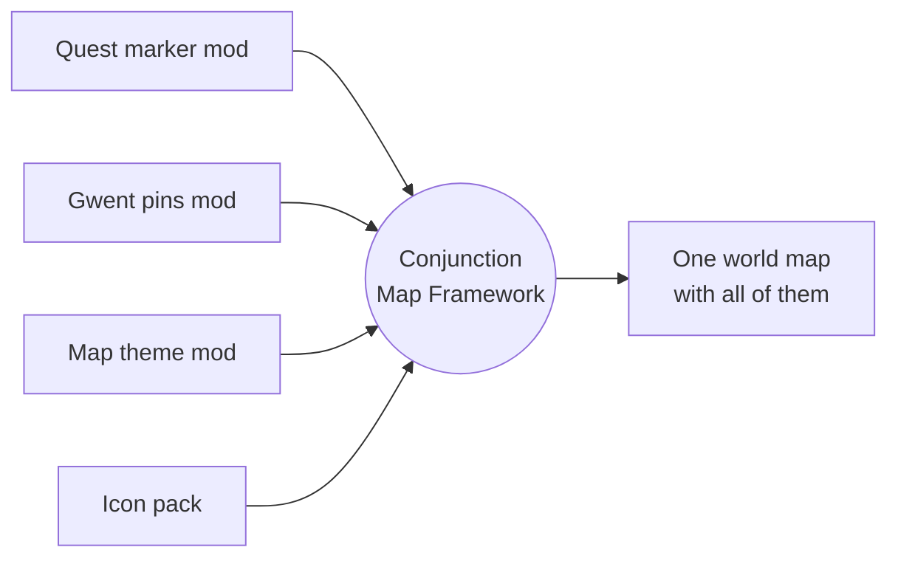

<div align="center">

# Conjunction Map Framework

**One world map for The Witcher 3 that map mods can share, and that you can build your own way.**

[](https://github.com/KyleCo76/Conjunction-Map-Framework/releases/latest)


[](LICENSE)

[**Download on Nexus Mods**](https://www.nexusmods.com/witcher3/mods/14693) · [**GitHub Releases**](https://github.com/KyleCo76/Conjunction-Map-Framework/releases) · [**For mod authors**](docs/wiki/Home.md) · [**Report a problem**](#reporting-problems)

</div>

---

## The problem CMF solves

In The Witcher 3 only **one** mod's world map file can load at a time. Map mods used to ship their own copy of that file, so whichever copy won switched off the map features of every other map mod: quest markers from one mod, Gwent pins from another and a travel route from a third could never all show together.

**Conjunction Map Framework (CMF)** becomes the game's one map. Other mods no longer replace the map; they tell CMF what they want shown. CMF settles once, when your game loads, whose icon, colour or legend row wins each spot, and draws the result every time you open the map.

**From 1.2.0, CMF does more than make map mods work together: you build your own map setup from the best parts of each mod.** Take the quest icons from one mod, the shop colours from another and the map's look from a third, and change your mind whenever you like.

> [!TIP]
> **Ink & Iron on CMF's map.** Ink & Iron's full map look, its "Lv N" quest tags and its smooth map movement all run on CMF's map, and from 1.3.0 the engraved world overview of its optional World Map file too. The same goes for the other mods under [Supported map mods](#supported-map-mods), including Map Quest Insight, Witcher's Path, Gwent Players Map, All Quest Objectives, Annoying Map and Map Remastered. CMF's own adapters do the proof-of-concept work, so none of these mods needed work from their authors for initial compatibility. The final check ran on a 175-mod everyday game, installed with RMMR.



> [!NOTE]
> **On its own, CMF changes nothing you can see.** With only CMF installed, the map looks exactly like the game's own. What it becomes depends on the CMF-ready mods and adapters you install beside it.

## Why CMF

Other map compatibility tools solve the same problem in their own ways, and many players have used them happily. CMF takes a different route.

- **Build your own setup, feature by feature.** With the optional [in-game menu add-on](#good-to-know) you choose in Options which of your map mods wins each feature: pin icons from one mod, pin colours from another, the map's look from a third. From 1.4.1 a mod's map behaviour (how stacked pins spread out, how the info box moves) is chosen apart from its look, so one mod's icons can go with another mod's spreading. Change your mind at any time, with nothing to reinstall.
- **Updates need no rebuild.** CMF builds nothing ahead of time. Each map mod tells CMF what it wants shown when your game loads, so when one of your map mods updates, you install the update and play. There is no combined map to rebuild. At most, a mod that uses a CMF adapter may get an updated adapter, and once its author supports CMF directly, the adapter goes away.
- **Mods stay as their authors ship them.** CMF changes no other mod's files, and its adapters contain none of the mod they adapt.

## Contents

- [Why CMF](#why-cmf)
- [For players](#for-players)
  - [What you need](#what-you-need)
  - [What to download](#what-to-download)
  - [Installing](#installing)
  - [Supported map mods](#supported-map-mods)
  - [Good to know](#good-to-know)
- [For mod authors](#for-mod-authors)
  - [What CMF can do for your mod](#what-cmf-can-do-for-your-mod)
  - [Your first pack in five steps](#your-first-pack-in-five-steps)
  - [Documentation](#documentation)
  - [Porting a mod that has a CMF adapter](#porting-a-mod-that-has-a-cmf-adapter)
- [Repository guide](#repository-guide)
- [Releases and checking a download](#releases-and-checking-a-download)
- [Reporting problems](#reporting-problems)
- [Credits and licence](#credits-and-licence)

---

## For players

### What you need

- **The Witcher 3: Wild Hunt Remastered**, Steam patch **5.01** (build 5.0.1048522), DirectX 12.
- **Windows**, or **Linux with Steam and Proton**: MateusAnd, the Gwent Players Map author, tested CMF 1.0.0 on Linux (keyboard and mouse); later versions have not been tried there yet. Steam Deck not confirmed.
- For each adapter: the mod it adapts, at the version named in the table below.

### What to download

CMF comes as separate archives. You always need CMF itself; take the rest only for the mods you play with. The newest version of each file is on the [Nexus Mods page](https://www.nexusmods.com/witcher3/mods/14693) and in [GitHub Releases](https://github.com/KyleCo76/Conjunction-Map-Framework/releases); each adapter's current version is in the [Supported map mods](#supported-map-mods) table.

| Archive | What it is | When to install it |
| --- | --- | --- |
| `mod0000_ConjunctionMapFramework` | CMF itself (1.5.0) | **Always** |
| `modCMFInGameMenu` | In-game menu add-on (1.5.0): choose in Options which map mod wins each feature | Optional. See [Good to know](#good-to-know) |
| `modCMFMinimapPanel` | Minimap add-on (2.1.0): your icon packs' icons and colours on the HUD minimap too, on top of whichever minimap you have | Optional. See [Good to know](#good-to-know) for the minimap and HUD mods it was tested with |
| `modCMFAdapterCheck` | Adapter check add-on (1.0.0): after a save loads, one box names each known map mod you have installed without its CMF adapter | Optional |
| `modCMFExampleIconPack` | Sample icon pack: a small example for pack authors | Optional |
| `modCMFAdapter…` (12 archives) | Adapters for 12 map mods that don't support CMF yet | Only for those mods you use, and only until the mod's author updates it for CMF. See [Supported map mods](#supported-map-mods) |

### Installing

1. Install CMF: copy its `Mods` and `bin` folders into your game folder and let Windows merge them.
2. Install your map mods as their authors describe.
3. If one of those mods is in the adapter list below, add its adapter's `Mods` folder. Many map mods need no adapter at all, and an adapter is only needed until that mod's author updates it for CMF.
4. Optionally add the in-game menu add-on (its `Mods` and `bin` folders) and the minimap add-on. Neither replaces a game file, so the minimap add-on goes in beside your HUD or minimap mod.
5. Start the game. The first start recompiles scripts and takes a little longer.

Every archive has a `README.txt` with its full install, update and removal steps. To remove CMF later, take out adapters and packs first, then the menu and minimap add-ons, then CMF. CMF writes nothing into your saves.

### Supported map mods

Many map mods work with CMF as they are, with no adapter. An **adapter** is a small stand-in for a mod that doesn't support CMF yet: it brings that mod's map features back on CMF's map while the mod itself stays exactly as its author ships it. Once the author updates the mod for CMF, you remove the adapter. Adapters **contain none of the mod they adapt** (only art its author gave for CMF, credited), add no features of their own, and **only work with that mod installed**: without it, the game stops at the script compile screen.

One exception: the **Coloured Map Markers** adapter also shows its icons without that mod installed. Coloured Map Markers is a map-file-only mod with no scripts an adapter could check, and its author's permission covers using its icons on their own. Keep Coloured Map Markers installed anyway if you like its minimap colours: it keeps colouring the minimap as before, and with the minimap add-on the adapter's icons show on top of that minimap too.

| Mod | Tested version | Adapter | What the adapter brings back |
| --- | --- | --- | --- |
| All Quest Objectives On Map - Remastered | 1.2.1 | **1.1.0** | Difficulty icons on quest objectives, its legend row, removing cached merchant pins |
| Annoying Map | 3.1 | **1.0.0** (new) | Its remembered map: each region opens where you left it, at that zoom, and the zoom keys reach the full range. Its hiding of Geralt, Roach, the boat and herbs works with or without the adapter |
| Botanist - NG - Remastered | 3.0.0.2 | 1.0.0 | Its herb markers and legend rows |
| Coloured Map Markers | 1.60 (optional, see above) | **1.0.1** | Its coloured icons: 60 of the mod's own Shape icons on 61 pin types (merchants, places, points of interest open and completed, crafting spots), used with permission |
| Fog of War | 1.2.1 | **1.0.1** | Hides every map icon under the fog, including other mods' icons |
| Gwent Players Map | 1.0.9 | **1.0.1** | Its card markers, in its author's own card art, and its "Gwent" tab |
| Ink and Iron - All in One | 0.8.10 (0.8.7 to 0.8.9 work too; 0.9.0 has the same scripts, not yet launched) | **1.2.1** | Ink and Iron's map look, quest level tags, key-hint row, map movement, its tall info box and its gold controller buttons (not yet tried with a real controller). With 1.2.0, also the engraved world overview and seven crests of its optional World Map file, in its author's own art, when you pick them in the menu |
| Map Pin Teleport | 1.2.2 | 1.0.0 | Teleporting from your own map pins |
| Map Quest Insight | 1.6.2 (1.6.1 works too) | **1.1.1** | Quest icons by type (main quest, contract and Gwent quest icons in its author's own art), coloured level labels, its info box, spreading stacked markers, and with 1.6.2 its Ultrawide map and Side panels position settings |
| The Stable - Roach-Horse Customization | 2.2.1 | 1.0.0 | Its Stables row on the map |
| Witcher Upgrade Gear Map | 1.0.1 | **1.0.1** | Its diagram markers, in its author's own art and school colours, its "Witcher Gear" tab and legend row |
| Witcher's Path | 1.0.3 | 1.0.0 | Its travel route drawn on the map, and its buttons |

<details>
<summary><b>Tested with no adapter needed, and mods that need their author's update</b></summary>

<br/>

**Tested, no adapter needed:** Map Remastered 2.4.2, All Quest Markers, Wild Monster Hunt, Wolf's Bearing (1.0; 1.1 checked in its files, also beside the minimap add-on), Apocrypha Menu Framework 1.0.6, HUD Position Manager 1.0.0, Reveal Map POI, Reveal Map Icons - Remastered (to see their icons, set the map's legend filter to All or Exploration).

**Checked in their files, no adapter needed, not yet seen in game:** Show Chests on Map (Remastered) 1.7, Show Quests on Map (Remastered) 1.4, Gwent Card Finder, Malaombra's Map 1.3.0, and Configurable Minimap Zoom 1.1.2 (also beside the minimap add-on).

**Ultrawide Menus** 1.0.2 was tried beside CMF with its patcher run, and CMF's map loaded as usual. From 1.4.1 CMF's map fills wide screens by itself, so Ultrawide Menus is not needed for the map.

**Not supported yet (needs its author's update):** some map mods keep their map features, and often their icon art, inside their own copy of the world map file. CMF never copies another mod's art or files unless its author permits it, so those features stay hidden under CMF until the author updates the mod for CMF or gives permission for an adapter to use them. The mod's scripts and menus keep working meanwhile. Community Patch - World Map is in this group: everything it changes lives in its own map file, so CMF has no adapter for it.

**Supports CMF itself:** [Smooth Map Remastered](https://www.nexusmods.com/witcher3/mods/13530) by Narcolepsy now supports CMF itself. Install it as its own page describes; it needs no CMF adapter.

The full, current list is on the [Nexus Mods page](https://www.nexusmods.com/witcher3/mods/14693).

</details>

<details>
<summary><b>Known differences</b></summary>

<br/>

- **Placeholder art** in the All Quest Objectives and Botanist adapters, until those authors supply theirs. The Gwent Players Map and Witcher Gear Map adapters (1.0.1), the Map Quest Insight adapter (1.0.1) and the Ink and Iron adapter (1.2.0) use their authors' own art. CMF ships another mod's art only when its author permits it, and credits them.
- **Ink and Iron's World Map file art** (the engraved world overview and crests) shows only when you pick Ink and Iron on the menu's World overview and Region crests and markers rows, or in the settings file: the game cannot tell whether that optional file is installed. Without it, change nothing.
- **Fog of War's clouds** do not draw on CMF's map until Fog of War supports CMF; the hiding works.
- **Show Chests on Map's** optional white chest icon is written into the game's own files, so on CMF's map chests show the game's own chest icon (from its files, not seen in game).
- **Gwent Card Finder beside the Map Pin Teleport adapter:** Card Finder's pins show Map Pin Teleport's "Go Now" button, which most likely does nothing on them (from their files, not seen in game).
- **Malaombra's Map:** with its "names only on hover" option on, it also hides the quest level labels that CMF adapters draw (from its files, not seen in game).
- **Ultrawide Menus:** run its patcher, as its page says. Without it, its own map file loads ahead of CMF's.
- **Map Remastered's** own region emblems on the world overview do not show; its redrawn terrain does.
- **Witcher's Path:** its speed setting does nothing under CMF.
- **World Map Merger** is not compatible with CMF, by design: it merges map mods into a map file of its own, which loads in place of CMF's map. Use one or the other.
- **Map Pin Teleport:** the "Go Now" texts are English, as in the mod itself.
- Per-mod details are in each adapter's `README.txt` and in the release's `test-notes.md`.

</details>

### Good to know

- **The in-game menu add-on (1.5.0) is optional.** With `modCMFInGameMenu` installed, Options > Mods > Conjunction Map Framework lets you choose which of your map mods wins each feature.
  - **Mod order** ranks your map mods once; **Basic choices** has one row per feature (pin icons, pin colours, legend, map look, map behaviour, map movement and more); **Advanced choices** splits a feature further, such as quest icons from one mod and shop icons from another; **Status** shows which mod wins each piece now, and why.
  - Every row starts on **Automatic**, which keeps CMF's usual winner and names it in brackets. **Vanilla** uses the game's own look; or pick one of your loaded map mods.
  - Highlight a row and the help box, just above the list, says in plain words what that row changes on the map, for example "Makes the map's pins bigger or smaller." On a choice row the next line names every loaded map mod that offers it, for example "Offered by: Botanist, Map Quest Insight". Some offers are known only after the world map has been opened once in a session, and the box says so until then.
  - At the title screen, before a save is loaded, the choice rows and Mod order rows show your choices greyed and cannot be changed. Load a save to change them. Reset on the General page still works there.
  - With CMF 1.3.0 or later, Advanced choices also has World overview, Region crests and markers and Opening view rows, with their Who wins rows.
  - From 1.3.0 the Basic row **Map behaviour**, with its own Advanced and Who wins pages, covers how stacked pins spread out, which pin leads a spread, label place and hiding, how the info box moves out of the way, its height and scrolling, and names only on hover. CMF adds no behaviour of its own: each one comes from a map mod. "Pin size and spreading" is now "Pin size", and "Pan and zoom" is now "Pan and zoom feel", with Zoom out to the whole region, Controller crosshair and Fill wide screens as their own rows. Picks made in 1.2.0 on the three rows that moved under Map behaviour count as Automatic again.
  - Menu add-on 1.3.0 and later need CMF 1.4.1 or later; with an older CMF the game stops at the script compile screen, so update CMF first.
  - The more specific choice wins: Advanced beats Basic, and Basic beats Mod order. No restart is needed: the minimap add-on follows as soon as Options closes, and the world map the next time you open it.
  - Hidden pins add up: every mod's hides apply, unless you keep only one mod's, none (Vanilla), or leave out up to three mods.
  - Without the add-on every choice is Automatic, and choices it left behind are ignored. The same choices can also go into `dx12user.settings` by hand, with the game closed: `CMFFile_…` lines under a `[CMFSettings]` heading (add the heading if it is missing), listed in CMF's `README.txt`.
- **A missing adapter is easy to spot.** CMF warns once per session when another mod's map file loads instead of CMF's. The optional adapter check add-on (`modCMFAdapterCheck`, with an Off/On setting under Options > Mods) names, after a save loads, each known map mod installed without its CMF adapter, and where to get it. Or open `CMF-Adapter-List.html` from the GitHub Release in your browser and paste your mod folder names.
- **Wide and tall screens.** From 1.4.1 the map fills 21:9, 32:9 and 16:10 screens instead of showing a 16:9 picture with dark sides, and its panels and button hints move to the screen's edges. On a 16:9 screen nothing changes. A map mod can switch this off or set it its own way; the menu's **Fill wide screens** row (Advanced, map movement) picks whose way wins, and Vanilla keeps the 16:9 map. Tested at 21:9 (3440 x 1440) and 16:10 (1920 x 1200); 32:9 has not been tried yet.
- **When two mods want the same spot**, a "hide" beats any icon or colour; otherwise, with nothing chosen, the mod whose folder name sorts first wins. Your mod manager's load order does not change this. To pick a winner without the menu add-on, list folder names in `Documents\The Witcher 3\dx12user.settings` (details in the [author guide, section 11](docs/authors/icon-pack-guide.md#11-for-players-installing-cmf-icon-packs-and-other-map-mods)):
  ```ini
  [CMFSettings]
  CMFProviderOrder1=modMyFavouritePack
  CMFProviderOrder2=modOtherPack
  ```
- **When a mod ships its own CMF support, uninstall CMF's adapter for it.** With both installed, the game stops at the script compile screen.
- **The minimap add-on (2.1.0) replaces no game file.** It adds its own small HUD part on top of whichever minimap is installed and draws your icon packs' art on the pins a pack claims. It never moves, resizes or hides the minimap, and pins no pack claims stay as your minimap draws them.
  - Tested with the game's own minimap, HUD Position Manager 1.0.0, Ink and Iron 0.8.10, Map Remastered 2.4.2 and Coloured Map Markers 1.60, and removed cleanly after each. Other minimap and HUD mods have not been tried with it yet.
  - On the minimap it changes pins by type only. A pin type a pack hides everywhere (every notice board, say) is hidden there too, though a quest ring or glow the minimap draws round it can still show (the hide was tested on Ink and Iron 0.8.10's minimap). A pack's change to only some pins of a type (one particular notice board, or every pin except quest ones) shows on the world map only.
  - Coming from an older add-on: 2.1.0 replaces 2.0.0 or 1.0.0 in the same `modCMFMinimapPanel` folder. Unlike 1.0.0, it no longer has to stay away from other minimap mods.
- **Do not give another map mod a lower `Priority` than CMF** in `mods.settings`; that switches CMF's map off.
- **The map moves at 60 frames per second** by default.

> [!IMPORTANT]
> **Not tested:** controllers and the Steam Deck. CMF 1.4.1 was tested on Windows with keyboard and mouse at 16:9, 16:10 and 21:9, with Map Quest Insight 1.6.2 and its adapter. CMF 1.3.0's controller button pictures were seen through a test copy of the map, not yet with a real controller. CMF 1.0.0 and 1.1.0 were tested on Windows with keyboard and mouse, both with the files copied in by hand and installed with RMMR in a full, everyday game setup. CMF 1.2.0 and the in-game menu add-on were tested on Windows with keyboard and mouse with Ink and Iron, Map Quest Insight, Coloured Map Markers, Gwent Players Map and Witcher Gear Map and their adapters, not yet in a full everyday setup. CMF 1.3.0, the menu add-on 1.2.0 and the Annoying Map and Ink and Iron adapters were tested on Windows with keyboard and mouse beside 27 mod folders, in three starts: test packs with placeholder art, Annoying Map with its adapter, and Ink and Iron's art. On Linux (Steam with Proton, keyboard and mouse) MateusAnd, the Gwent Players Map author, tested CMF 1.0.0 with the Gwent Players Map, Witcher Gear Map and Map Pin Teleport adapters: scripts compiled, the game started, and every adapter feature worked.

---

## For mod authors

CMF lets your mod change the world map **without shipping a map file**: no decompiling Flash, no Script Merger, no compatibility patches for other map mods. Your mod calls CMF from its own scripts, and works beside every other mod that uses CMF.

Three rules shape everything CMF offers:

1. **Abilities, not special cases.** Every ability is one general call that takes its target as an argument. CMF has no calls made for one particular mod, and names (pin types, tags, tab ids, folder names) are open, so your mod can style a pin another mod added.
2. **Clear winners.** When two mods ask for the same thing, a hide wins; otherwise the folder name that sorts first wins, unless the player picks a winner, for a whole mod or one feature at a time. CMF settles this when the game loads, and again when the player changes a choice.
3. **The version number is a promise.** `CMFGetVersion()` returns CMF's script interface version (**11** in 1.5.0), not a release number. Nothing is removed from 1.0.0 on; later versions only add.

### What CMF can do for your mod

| Ability | Since API version | Guide section |
| --- | --- | --- |
| Pin icons, legend icons and colour tints, for a whole pin type or one pin by its tag | 1 | [The CMF calls](docs/authors/icon-pack-guide.md#the-cmf-calls) |
| Replace a map area's background image | 1 | [The CMF calls](docs/authors/icon-pack-guide.md#the-cmf-calls) |
| Grey out pins (looks only, they stay usable) | 1 | [Greying pins](docs/authors/icon-pack-guide.md#greying-pins-api-version-1) |
| Your own legend rows and filter tabs | 2 | [Legend rows and filter tabs](docs/authors/icon-pack-guide.md#legend-rows-and-filter-tabs-api-version-2) |
| Style a single pin as the map builds it | 2 | [Styling one pin](docs/authors/icon-pack-guide.md#styling-one-pin-api-version-2) |
| Hide pins, with exemptions for tracked, quest and fast travel pins | 3 | [Hiding pins](docs/authors/icon-pack-guide.md#hiding-pins-api-version-3) |
| Pin size, pin labels, the info box height, hiding pins in a filter tab | 4 | [Pin size, labels and the info box](docs/authors/icon-pack-guide.md#pin-size-labels-and-the-info-box-api-version-4) |
| A hook on every pin as the map builds it (`CMFCore.OnPinReady`) | 4 | [The pin hook](docs/authors/icon-pack-guide.md#the-pin-hook-onpinready-api-version-4) |
| Key hints and filter tab reports | 4 | [Key hints](docs/authors/icon-pack-guide.md#key-hints-and-filter-tab-reports-api-version-4) |
| A full map theme: frames, fonts, colours, legend and backdrop | 5 | [The map theme](docs/authors/icon-pack-guide.md#the-map-theme-api-version-5) |
| Info box extras for themes: a drawing that shows only while the box is tall (`minPartHeight`), and a tall box moved beside the cursor, clear of the other panels (the `clear…` keys) | 7 | [Theme parts and keys](docs/wiki/Theme-Parts-and-Keys.md) |
| Pin clicks handed back to your script, with button text | 6 | [Pin clicks](docs/authors/icon-pack-guide.md#pin-clicks-api-version-6) |
| Smooth map movement | 6 | [Smooth map movement](docs/authors/icon-pack-guide.md#smooth-map-movement-api-version-6) |
| Spreading stacked pins apart | 6 | [Spreading stacked pins](docs/authors/icon-pack-guide.md#spreading-stacked-pins-api-version-6) |
| Drawing lines and images on the map itself | 6 | [Drawing on the map](docs/authors/icon-pack-guide.md#drawing-on-the-map-itself-api-version-6) |
| A tidy name for your mod in the player's in-game menu (`CMFSetProviderName`) | 8 | [API reference](docs/wiki/API-Reference.md) |
| The world overview: its painting (one picture or tiles), region crests and markers | 9 | [World overview pictures](docs/wiki/World-Overview-Pictures.md) |
| Controller button pictures on the map | 9 | [Controller button pictures](docs/wiki/Controller-Button-Pictures.md) |
| Where the player left the map (`CMFCore.OnMapView`), and the view a region map opens with (`OnMapOpening`, `CMFSetOpeningView`) | 9 | [The map's view](docs/wiki/Map-View.md) |
| Pictures that show only when the player picks your mod (`CMFRegisterChoiceOnly`) | 9 | [Choice-only claims](docs/wiki/Choice-Only-Claims.md) |
| Hiding Geralt's marker (a hide on `'Player'`) | 9 | [Hiding pins](docs/wiki/Hiding-Pins.md) |
| Filling wide and tall screens your own way (the theme part `wide`), and the screen size (`CMFScreenWidth`, `CMFScreenHeight`) | 10 | [Wide and tall screens](docs/wiki/Wide-Screens.md) |
| Names only on hover (property 28) | 10 | [Names only on hover](docs/wiki/Names-Only-on-Hover.md) |
| Showing the map's panels as soon as it starts fading in (`readyAtFadeStart`) | 10 | [Map movement](docs/wiki/Map-Movement.md) |
| Changing one pin: its colour, info box title, text and height, "?" and cleared-place art, level variants, Geralt's arrow and player markers, moving the game's legend rows, hiding a whole tab | 11 | [API reference](docs/wiki/API-Reference.md) |
| Telling CMF your mod is there (`CMFDeclareProvider`, `CMFProviderPresent`), so the adapter check knows | 11 | [API reference](docs/wiki/API-Reference.md) |

A minimal pack, the whole script:

```c
@wrapMethod(CR4Game)
function OnGameStarted(restored : bool)
{
	var result : bool;
	result = wrappedMethod(restored);
	if (CMFRequireVersion("modAcmeIcons", 1))
	{
		CMFRegisterIcon("modAcmeIcons", 'Innkeeper', "img://icons/modacmeicons/innkeeper.png");
		CMFRegisterTint("modAcmeIcons", 'Herbalist', 4259648); // 0x40FF40, lime green
	}
	return result;
}
```

<sub>The same pattern as the [sample icon pack's script](examples/modCMFExampleIconPack/content/scripts/local/modcmfexampleiconpack_cmf.ws). `tools/cmf_pack.py skeleton` writes the start-up script for your own pack.</sub>

> [!WARNING]
> Calling a CMF function that the installed CMF does not have stops the game at the script compile screen. Check with `CMFHasProperty(id)` or `CMFRequireVersion(provider, version)` before using anything newer than the version your mod requires, and never name your own functions with the `CMF` prefix.

### Your first pack in five steps

1. Copy [`examples/modCMFExampleIconPack`](examples/modCMFExampleIconPack/) and rename the folder, for example `modAcmeIcons`.
2. Put your PNG icons in its `art/` folder.
3. Run `python tools/cmf_pack.py skeleton path/to/modAcmeIcons` and paste what it prints into your start-up script.
4. Write the player `README.txt` from [the template](docs/authors/pack-readme-template.txt).
5. Run `python tools/cmf_pack.py build path/to/modAcmeIcons --out path/to/out`, fix anything it reports, and copy the `Mods` folder it writes into the game.

The pack tool needs only Python 3 and its standard library. It checks your art and script and builds the texture cache the game reads.

### Documentation

| Document | What is in it |
| --- | --- |
| [Mod author docs](docs/wiki/Home.md) | **Start here.** The guide as short pages, one per ability, with an API reference |
| [Author guide](docs/authors/icon-pack-guide.md) | Everything: art, every CMF call by API version, building, testing, shipping, settings and text, what CMF does not do yet |
| [Pin types](docs/authors/pin-types.md) | All 162 pin type names of the 5.01 world map, with their legend tab and what a claim on each changes |
| [Porting pages](docs/authors/) | One page per adapted mod: "you used to do this; now call these CMF functions" |
| [Script-side map bindings](docs/api/engine-bindings.md) | Advanced: the callbacks and values that pass between scripts and CMF's map |

> **New to CMF?** Start at the [mod author docs](docs/wiki/Home.md): the same guide split into short pages, one per topic, from [what you want to change](docs/wiki/Abilities.md) to [getting started](docs/wiki/Getting-Started.md) and a full [API reference](docs/wiki/API-Reference.md).

### Porting a mod that has a CMF adapter

The adapters are teaching examples, written as the code that mod's own author would add. If your mod has one, its porting page shows the CMF calls that give the same result once your mod supports CMF itself. Fold them into your mod (CMF then becomes a requirement), and the standalone adapter is retired: players uninstall it and use your release.

| Your mod | Porting page | Adapter source |
| --- | --- | --- |
| All Quest Objectives On Map - Remastered | [page](docs/authors/all-quest-objectives-adapter.md) | [source](source/adapters/all-quest-objectives/) |
| Annoying Map | [page](docs/authors/annoying-map-adapter.md) | [source](source/adapters/annoying-map/) |
| Botanist - NG - Remastered | [page](docs/authors/botanist-adapter.md) | [source](source/adapters/botanist/) |
| Fog of War | [page](docs/authors/fog-of-war-adapter.md) | [source](source/adapters/fog-of-war/) |
| Gwent Players Map | [page](docs/authors/gwent-players-map-adapter.md) | [source](source/adapters/gwent-players-map/) |
| Ink and Iron | [page](docs/authors/ink-and-iron-adapter.md) | [source](source/adapters/ink-and-iron/) |
| Map Pin Teleport | [page](docs/authors/map-pin-teleport-adapter.md) | [source](source/adapters/map-pin-teleport/) |
| Map Quest Insight | [page](docs/authors/map-quest-insight-adapter.md) | [source](source/adapters/map-quest-insight/) |
| The Stable | [page](docs/authors/the-stable-adapter.md) | [source](source/adapters/the-stable/) |
| Witcher Upgrade Gear Map | [page](docs/authors/witcher-gear-map-adapter.md) | [source](source/adapters/witcher-gear-map/) |
| Witcher's Path | [page](docs/authors/witchers-path-adapter.md) | [source](source/adapters/witchers-path/) |

The Coloured Map Markers adapter has no porting page: that mod has no scripts, so the adapter is only its icons registered with CMF ([source](source/adapters/coloured-map-markers/)).

**Smooth Map** now supports CMF itself: see [Smooth Map Remastered](https://www.nexusmods.com/witcher3/mods/13530) by Narcolepsy. Community Patch - World Map has a porting section in the [author guide, section 12](docs/authors/icon-pack-guide.md#12-teaching-examples-moving-a-map-mod-onto-cmf); no adapter ships for it.

---

## Repository guide

<details>
<summary><b>What is where</b></summary>

<br/>

| Path | What |
| --- | --- |
| `source/core` | CMF's scripts (`cmfCore.ws`, `cmfSettings.ws`) |
| `source/settings`, `source/strings.json` | CMF's menu file and the source of its string tables |
| `source/panel` | the edit sets CMF applies to the game's world map panel, and CMF's own ActionScript classes |
| `source/menu` | the in-game menu add-on: its script, menu file and string source |
| `source/minimap` | the minimap add-on: its script and its own HUD part's ActionScript class |
| `source/adapters` | the 12 adapters, one folder each, with a developer `README.md` and the shipped pack folder |
| `examples/modCMFExampleIconPack` | the sample icon pack, to copy from |
| `source/providers` | developer test packs (never shipped) |
| `docs/authors`, `docs/api` | the author guide, pin type list, porting pages and map bindings |
| `tools` | build tools: packs, panels, string tables, releases |
| `tests` | unit tests for the tools and the shipped scripts |
| `source/releases` | release notes and the release spec |

</details>

<details>
<summary><b>Building and testing</b></summary>

<br/>

Python 3 runs the tools and tests:

```sh
python3 -m unittest discover -s tests
python3 tools/cmf_pack.py build source/adapters/gwent-players-map/modCMFAdapterGwentPlayersMap \
    --out build/gwent --adapts modGwentPlayersMap
```

Every shipped adapter and the sample pack rebuild from this repository byte for byte equal to the release archives. Rebuilding the world map panel itself needs the game's own panel file and FFDec; see `tools/cmf_pin_panel.py`.

</details>

<details>
<summary><b>Branches</b></summary>

<br/>

- `main` holds published releases only, one tagged commit per version (`v1.0.0`, ...).
- `develop` is where work lands; a release is a merge of `develop` into `main`.

</details>

## Releases and checking a download

Each version has a [GitHub Release](https://github.com/KyleCo76/Conjunction-Map-Framework/releases) with the same archives as on Nexus Mods, plus `SHA256SUMS`, `test-notes.md` (how it was tested and what was not) and `rollback-notes.md` (removing it or going back).

To check a download in PowerShell, in the folder with the archive:

```powershell
Get-FileHash .\mod0000_ConjunctionMapFramework-1.5.0.zip -Algorithm SHA256
```

The result must equal that file's line in `SHA256SUMS`.

## Reporting problems

Report bugs on the Nexus Mods page's **Bugs** tab, or [open an issue](https://github.com/KyleCo76/Conjunction-Map-Framework/issues) here.

Please include your CMF version, the map mods and adapters you have installed, and the `CMF` lines from your script log if you have one.

## Credits and licence

Made by Kyle with the help of AI tools (Claude and ChatGPT). Every published file is reviewed by Kyle.

Card and gear art in the Gwent Players Map and Witcher Gear Map adapters by **MateusAnd**, the author of both mods, used with permission. Thanks to MateusAnd for testing CMF on Linux.

World overview painting, region crests and gold controller button pictures in the Ink and Iron adapter by **WinterElfeas**, the author of Ink and Iron, used with permission.

CMF's smooth map movement and quicker map opening are built on the work of **Narcolepsy**, the author of [Smooth Map](https://www.nexusmods.com/witcher3/mods/13530): much of that code in CMF's map file follows Smooth Map's.

Main quest, contract and Gwent quest icons in the Map Quest Insight adapter by **Wolfer**, the author of Map Quest Insight, used with permission.

Icons in the Coloured Map Markers adapter by **DJ_Kovrik**, from [Coloured Map Markers](https://www.nexusmods.com/witcher3/mods/938) (maintained by LewisElementary), used with permission under the mod's compatibility notice. The adapter is not made by DJ_Kovrik or LewisElementary; questions about it go to CMF's page.

Thanks to the authors of the map mods CMF adapts. Their mods stay theirs; CMF's adapters contain none of their files, and their art only where the author gave it for CMF, credited.

**Licence:** [Creative Commons Attribution-NonCommercial 4.0](https://creativecommons.org/licenses/by-nc/4.0/) (CC BY-NC 4.0), full text in [`LICENSE`](LICENSE). Anyone may copy, change and share CMF, including inside their own free mods, as long as they credit Kyle and do not sell it or use it commercially.

This is an unofficial fan work and is not approved/endorsed by CD PROJEKT RED.
